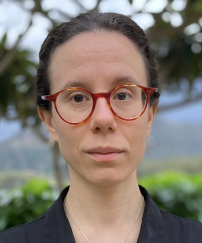

```{=html}
<nav class="jump"><a href="#publications">Publications</a><a href="#teaching">Teaching</a><a href="cv.pdf">CV</a></nav>
```

::: {.profile}
::: {.photo}
{fig-alt="Photo of Clara Fontdevila"}

:::

::: {.intro}
# Clara Fontdevila

::: {.role}
[Ramón y Cajal Researcher, Department of Sociology]{.role-main}\
Universitat Autònoma de Barcelona
:::

My research sits at the intersection of education policy and the sociology of education and is concerned with the reform and restructuring of education systems from an equity perspective, examining how policy and institutional arrangements change, and with what consequences for whom. My current work focuses on school quasi-markets, which I approach from two angles: the rules that govern them and their role in producing or mitigating segregation, and how schools respond to diversity and to public-interest expectations in competitive environments. Much of my empirical work centres on publicly funded religious schools, with a focus on Spain and France.

Before rejoining the Universitat Autònoma de Barcelona as a Ramón y Cajal Researcher, I held postdoctoral positions at the University of Glasgow, most recently as a British Academy Postdoctoral Fellow.

::: {.links}
[ORCID](https://orcid.org/0000-0003-0589-558X) [Google Scholar](https://scholar.google.com/citations?user=OY6zz8oAAAAJ&hl=en) [LinkedIn](https://www.linkedin.com/in/clara-fontdevila-b49005aa/) [Email](mailto:Clara.Fontdevila@uab.cat)
:::

:::
:::

## Publications {#publications}

```{=html}
<div class="chips">
  <button class="chip active" data-topic="all">All</button>
  <button class="chip" data-topic="markets">Education markets &amp; private schooling</button>
  <button class="chip" data-topic="religious">Religious schools</button>
  <button class="chip" data-topic="inequality">Education inequalities</button>
  <button class="chip" data-topic="teachers">Teaching profession</button>
  <button class="chip" data-topic="evaluation">Assessment &amp; evaluation</button>
  <button class="chip" data-topic="io">International organizations</button>
</div>
```

::: {#pubs}
:::

## Teaching {#teaching}

::: {.teaching}
- **Actors in Education and Development** (MA Education Policies for Global Development – GLOBED, UAB · course leader, 2021–22, 2022–23, 2025–26) · [Syllabus](syllabus-actors-education-development.pdf)
- **Education Policy** (BA Sociology, UAB · course leader, 2021–22, 2026–27)
:::

::: {.footer-note}
Department of Sociology, Edifici B, Campus UAB · 08193 Cerdanyola del Vallès, Barcelona
:::
